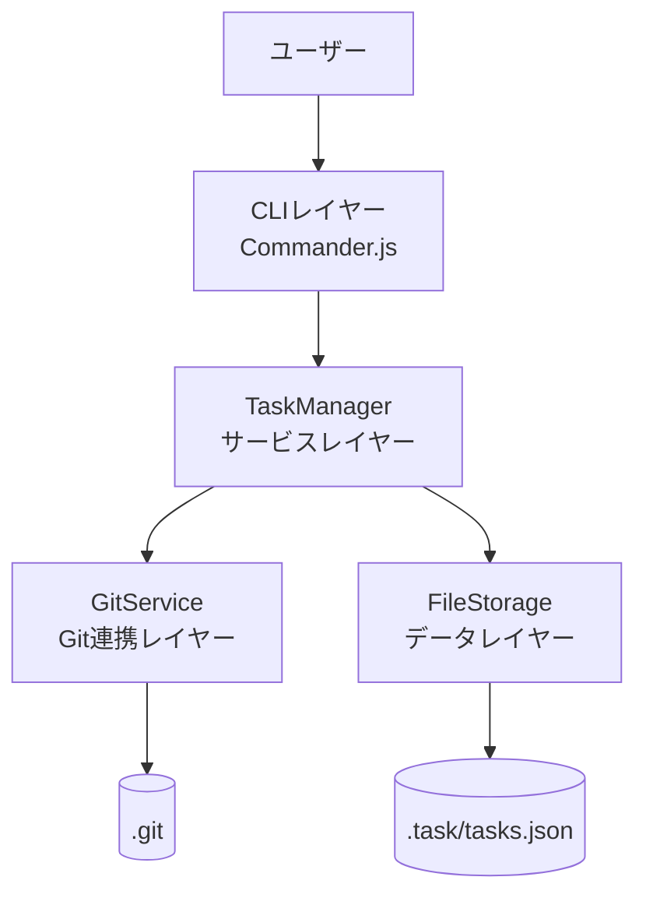
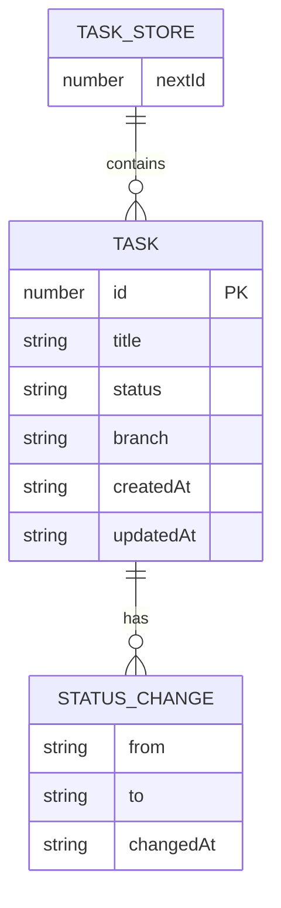
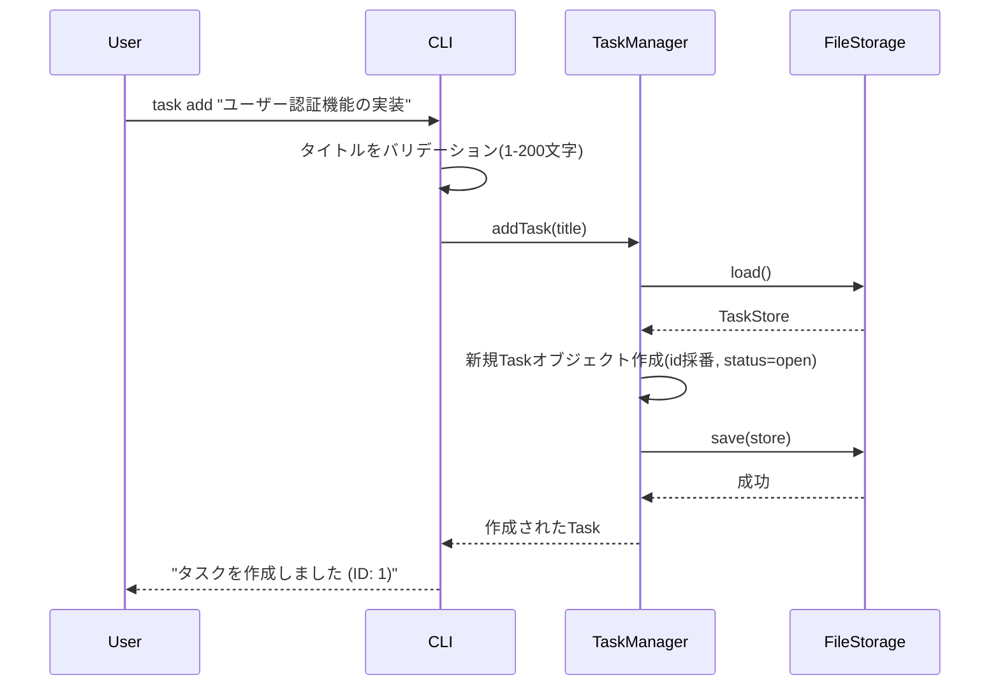
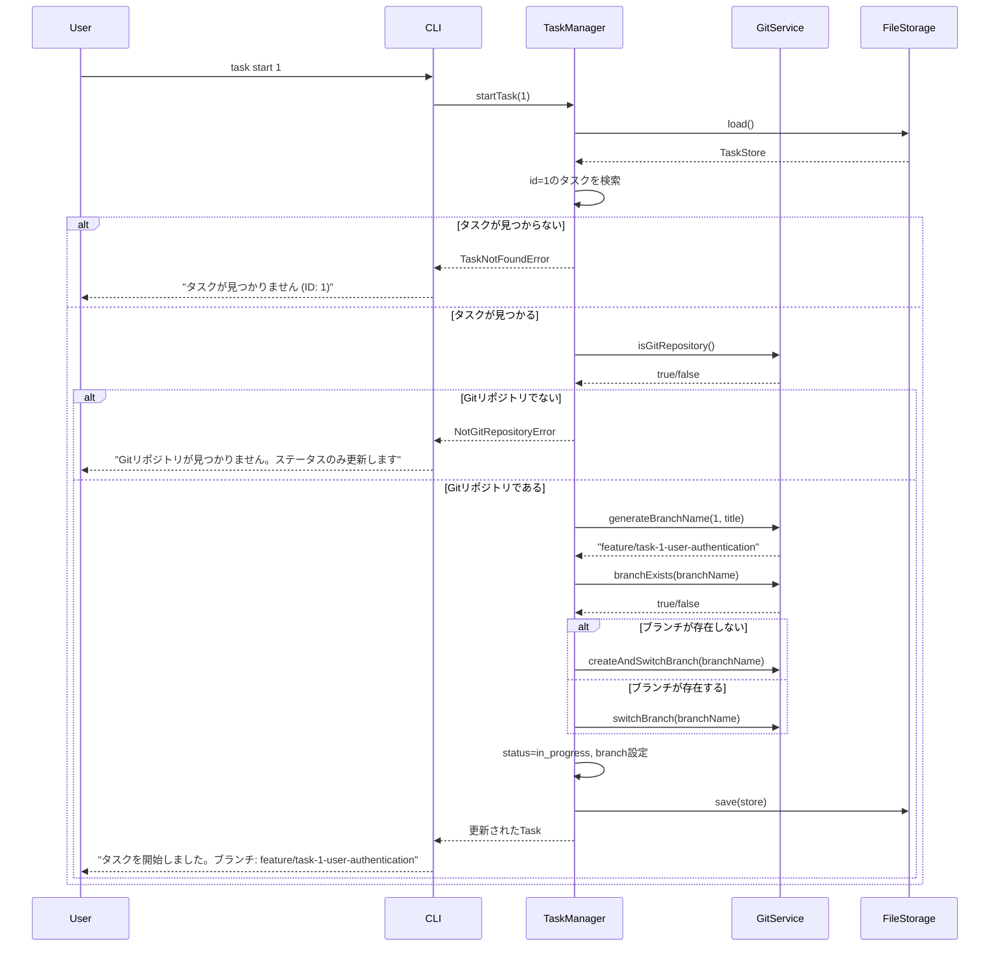
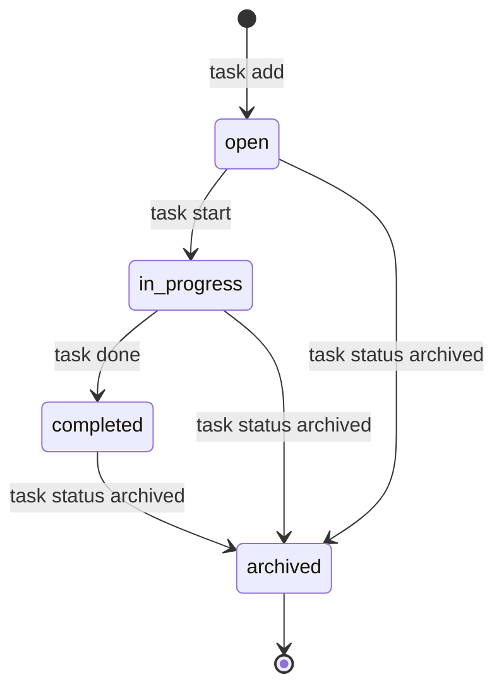

# 機能設計書 (Functional Design Document)

## システム構成図



MVPスコープではGitHub連携(P1)は含めないため、GitHub APIクライアントは本設計書の対象外とする。

## 技術スタック

| 分類 | 技術 | 選定理由 |
|------|------|----------|
| 言語 | TypeScript 5.x | 型安全性により、タスクのステータス遷移やCLI引数のバリデーションを静的に検証できる |
| ランタイム | Node.js v24.x | devcontainerの標準環境。クロスプラットフォーム対応が容易 |
| CLIフレームワーク | Commander.js | PRD記載の選定理由の通り、学習コストが低くMVPに必要な機能(サブコマンド、オプション)を満たす |
| Git連携 | simple-git | PRD記載の通り、ブランチ作成・切り替え・コミット情報取得をPromiseベースで簡潔に扱える |
| データストア | JSONファイル(`.task/tasks.json`) | MVPではSQLiteを導入せず、依存を増やさずGit管理下に置ける形式を採用(PRDのスケーラビリティ要件) |
| テーブル表示 | cli-table3 | `task list` の表形式出力とカラーコーディングに対応 |
| カラー出力 | chalk | ステータス・優先度の色分け表示に使用 |
| テスト | Vitest | TypeScript/ESMとの親和性が高く、高速に実行できる |

## データモデル定義

### エンティティ: Task

```typescript
interface Task {
  id: number;                    // 連番ID(1から自動採番)
  title: string;                 // 1-200文字
  status: TaskStatus;            // タスクのステータス
  branch?: string;                // 紐づくGitブランチ名(task start実行後に設定)
  createdAt: string;              // 作成日時(ISO 8601)
  updatedAt: string;              // 更新日時(ISO 8601)
  statusHistory: StatusChange[];  // ステータス変更履歴
}

type TaskStatus = 'open' | 'in_progress' | 'completed' | 'archived';

interface StatusChange {
  from: TaskStatus | null;  // 初回作成時はnull
  to: TaskStatus;
  changedAt: string;         // ISO 8601
}
```

**制約**:
- `id` はタスクストア内で一意。削除されたIDは再利用しない(採番用のカウンタを別途保持)
- `title` は1文字以上200文字以内、前後の空白はトリムする
- `status` の初期値は常に `open`
- `branch` は `task start` 実行時に `feature/task-<id>-<スラッグ>` 形式で設定される

### データストア: TaskStore

```typescript
interface TaskStore {
  nextId: number;   // 次に採番するID
  tasks: Task[];
}
```

### ER図



## コンポーネント設計

### CLIレイヤー(CLI)

**責務**:
- コマンドライン引数のパースとバリデーション
- TaskManagerの呼び出し
- 結果・エラーのフォーマットとターミナルへの出力

**インターフェース**:
```typescript
class CLI {
  registerCommands(program: Command): void;
  displayTaskList(tasks: Task[]): void;   // cli-table3で表形式出力
  displayTaskDetail(task: Task): void;
  displaySuccess(message: string): void;
  displayError(error: TaskCliError): void;
}
```

**依存関係**:
- TaskManager

### サービスレイヤー(TaskManager)

**責務**:
- タスクのCRUD操作とステータス遷移のビジネスロジック
- Git連携(ブランチ作成・切り替え)のオーケストレーション
- FileStorageを介した永続化の呼び出し

**インターフェース**:
```typescript
class TaskManager {
  addTask(title: string): Task;
  listTasks(filter?: { status?: TaskStatus }): Task[];
  getTask(id: number): Task;
  startTask(id: number): Task;          // ステータスをin_progressに変更しGitブランチを作成/切り替え
  completeTask(id: number): Task;       // ステータスをcompletedに変更
  changeStatus(id: number, status: TaskStatus): Task;
  deleteTask(id: number): void;
}
```

**依存関係**:
- FileStorage
- GitService

### Git連携レイヤー(GitService)

**責務**:
- Gitリポジトリの存在確認
- ブランチの作成・切り替え
- タイトルからブランチ名用スラッグを生成

**インターフェース**:
```typescript
class GitService {
  isGitRepository(): Promise<boolean>;
  branchExists(branchName: string): Promise<boolean>;
  createAndSwitchBranch(branchName: string): Promise<void>;
  switchBranch(branchName: string): Promise<void>;
  generateBranchName(taskId: number, title: string): string; // feature/task-<id>-<slug>
}
```

**依存関係**:
- simple-git(外部ライブラリ)

### データレイヤー(FileStorage)

**責務**:
- `.task/tasks.json` の読み込み・書き込み
- アトミックな書き込み(一時ファイル経由でのrename)によるデータ破損防止
- 直近5世代のバックアップ保持

**インターフェース**:
```typescript
class FileStorage {
  load(): TaskStore;
  save(store: TaskStore): void;
  exists(): boolean;
  initialize(): TaskStore;   // .task/ディレクトリとtasks.jsonを新規作成
}
```

**依存関係**:
- Node.js `fs` モジュール

## ユースケース図

### タスク追加(task add)



**フロー説明**:
1. ユーザーがタイトルを指定して `task add` を実行
2. CLIがタイトルの文字数制約をバリデーション
3. TaskManagerが既存ストアを読み込み、`nextId` を使って新規タスクを作成
4. FileStorageがアトミックにJSONファイルへ書き込み
5. 作成結果をユーザーに表示

### タスク開始とブランチ自動作成(task start)



**フロー説明**:
1. ユーザーが `task start <id>` を実行
2. TaskManagerが対象タスクの存在を確認(存在しない場合はエラー表示して終了)
3. GitServiceがGitリポジトリかどうかを判定。リポジトリでない場合はGit連携をスキップし、ステータス更新のみ行う
4. ブランチ名を生成し、既存ブランチがあれば切り替え、なければ新規作成して切り替え
5. タスクのステータスを `in_progress` に変更し、`branch` フィールドを更新して保存

## 画面遷移図(ステータス遷移)



## UI設計

### テーブル表示(task list)

**表示項目**:
| 項目 | 説明 | フォーマット |
|------|------|-------------|
| ID | タスクの連番ID | 数値 |
| Status | 現在のステータス | 色付き文字列(open/in_progress/completed/archived) |
| Title | タスクタイトル | 文字列(30文字を超える場合は末尾を`...`で省略) |
| Branch | 紐づくブランチ名 | 文字列、未設定時は`-` |

```
ID  Status       Title                      Branch
1   in_progress  ユーザー認証機能の実装      feature/task-1-user-authentication
2   open         データエクスポート機能      -
3   completed    初期セットアップ           feature/task-3-initial-setup
```

### カラーコーディング

**ステータスの色分け**:
- `open`: 白(デフォルト)
- `in_progress`: 黄
- `completed`: 緑
- `archived`: グレー

ターミナルがカラー出力に対応していない場合(`process.stdout.isTTY === false` 等)は、chalkの自動判定によりプレーンテキストにフォールバックする。

## ファイル構造

**データ保存形式**:
```
.task/
├── tasks.json           # タスクデータ本体
└── backups/
    ├── tasks.json.1     # 直近1世代前のバックアップ
    ├── tasks.json.2
    ├── tasks.json.3
    ├── tasks.json.4
    └── tasks.json.5     # 直近5世代前のバックアップ
```

**tasks.json の例**:
```json
{
  "nextId": 4,
  "tasks": [
    {
      "id": 1,
      "title": "ユーザー認証機能の実装",
      "status": "in_progress",
      "branch": "feature/task-1-user-authentication",
      "createdAt": "2026-07-19T09:00:00.000Z",
      "updatedAt": "2026-07-19T09:15:00.000Z",
      "statusHistory": [
        { "from": null, "to": "open", "changedAt": "2026-07-19T09:00:00.000Z" },
        { "from": "open", "to": "in_progress", "changedAt": "2026-07-19T09:15:00.000Z" }
      ]
    }
  ]
}
```

## パフォーマンス最適化

- タスク一覧(`task list`)は起動時に一度だけJSONを読み込み、メモリ上でフィルタ・ソートを行うことでPRD要件(1000件を1秒以内)を満たす
- 書き込みはタスク1件の変更であってもストア全体を書き直すシンプルな方式とし、1000件規模ではボトルネックにならないことを想定する。将来的にタスク件数が増えパフォーマンス課題が出た場合はSQLite移行を検討する(PRDのスケーラビリティ要件)

## セキュリティ考慮事項

- MVPスコープ(P0)ではGitHub Personal Access Tokenを扱わないため、トークン保存に関するセキュリティ要件はP1(GitHub Issues連携)実装時に別途設計する
- `.task/tasks.json` はGit管理下に置かれることを想定するため、タスクのタイトルに機密情報を含めないようヘルプメッセージで注意喚起する

## エラーハンドリング

### エラーの分類

| エラー種別 | 処理 | ユーザーへの表示 |
|-----------|------|-----------------|
| タイトル文字数超過 | 処理を中断 | "タイトルは1〜200文字で入力してください" |
| タスクが見つからない | 処理を中断 | "タスクが見つかりません (ID: <id>)" |
| データファイル未作成 | 空のTaskStoreで初期化して継続 | "タスクデータが見つかりません。新規作成します" |
| Gitリポジトリでない | Git連携をスキップしステータス更新のみ継続 | "Gitリポジトリが見つかりません。ステータスのみ更新しました" |
| ブランチ作成失敗(名前衝突等) | 処理を中断 | "ブランチの作成に失敗しました: <詳細>" |
| データファイル破損(JSON parse失敗) | 直近のバックアップから復元を提案 | "タスクデータが破損しています。バックアップから復元しますか？ (y/N)" |
| 削除・アーカイブ確認 | ユーザーに確認プロンプトを表示 | "タスク <id> を削除しますか？ (y/N)" |

## テスト戦略

### ユニットテスト
- TaskManagerの各メソッド(addTask, listTasks, startTask, completeTask, changeStatus, deleteTask)
- GitServiceのブランチ名生成ロジック(`generateBranchName`のスラッグ化)
- FileStorageのアトミック書き込みとバックアップローテーション

### 統合テスト
- `task add` → `task list` で追加したタスクが一覧に表示されるシナリオ
- `task start` 実行後にステータスが`in_progress`に変わり、ブランチが作成されるシナリオ(simple-gitはテスト用一時リポジトリに対して実行)
- Gitリポジトリでないディレクトリで`task start`を実行した場合にステータス更新のみ行われるシナリオ

### E2Eテスト
- CLIバイナリを実際に呼び出し、`add → start → done` の一連のフローが正しく完了するシナリオ
- 1000件のタスクを持つ`tasks.json`に対して`task list`を実行し、応答時間がパフォーマンス要件(1秒以内)を満たすシナリオ
