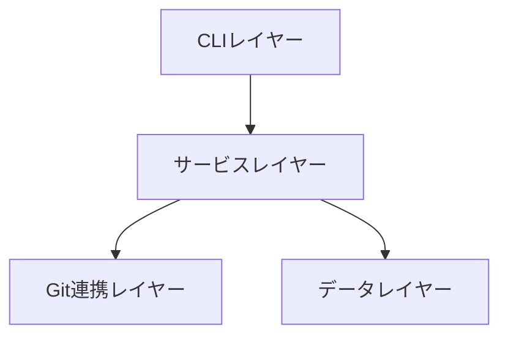
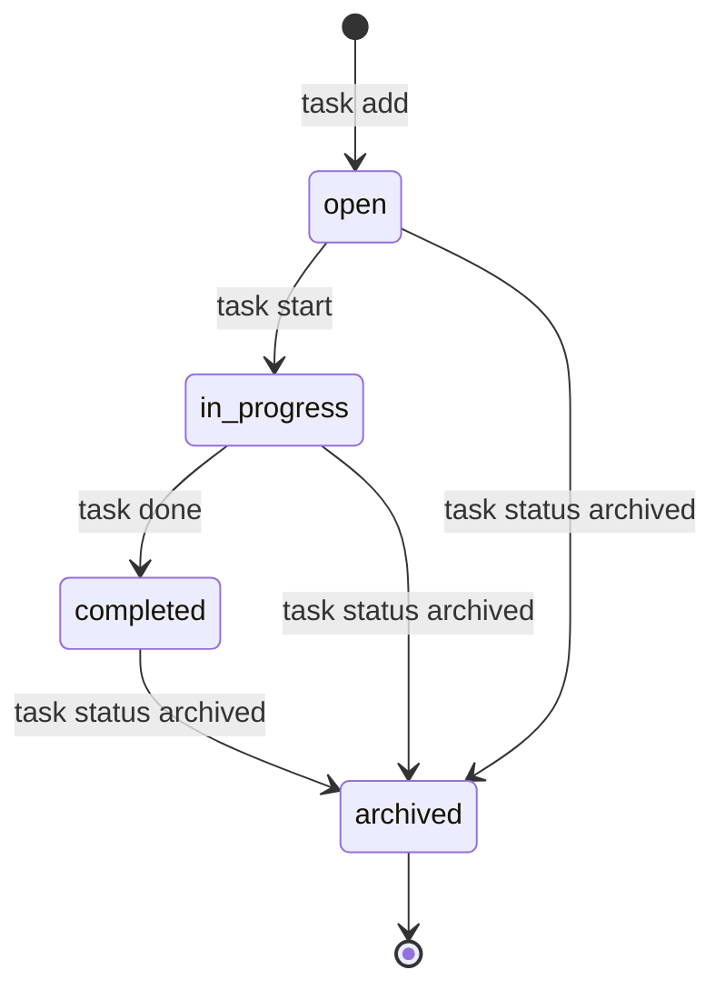

# プロジェクト用語集 (Glossary)

## 概要

このドキュメントは、TaskCLIプロジェクト内で使用される用語の定義を管理します。[product-requirements.md](./product-requirements.md), [functional-design.md](./functional-design.md), [architecture.md](./architecture.md), [repository-structure.md](./repository-structure.md), [development-guidelines.md](./development-guidelines.md) 全体で共通の語彙として使用してください。

**更新日**: 2026-07-19

## ドメイン用語

### タスク(Task)

**定義**: ユーザーが管理する作業単位。タイトル、ステータス、紐づくGitブランチなどの属性を持つ。

**説明**: `task add` で作成され、`task start` でGitブランチと紐付き、`task done` で完了する、TaskCLIの中心的なエンティティ。

**関連用語**: [[タスクステータス]], [[ブランチ連携]]

**使用例**:
- `task add "ユーザー認証機能の実装"`
- `task show 1`

**英語表記**: Task

### タスク開始(Task Start)

**定義**: タスクを`in_progress`ステータスに変更し、対応するGitブランチを作成・切り替える操作。

**説明**: `task start <id>` コマンドで実行される。TaskCLIの中核的な差別化機能である「タスクとGitブランチの自動連携」を実現する操作。

**関連用語**: [[ブランチ連携]], [[タスクステータス]]

**使用例**:
- `task start 1` → `feature/task-1-user-authentication` ブランチを作成し切り替え

### ブランチ連携

**定義**: タスクとGitブランチを1対1で紐付け、ブランチ名を `feature/task-<id>-<スラッグ>` 形式で自動生成する仕組み。

**説明**: PRDの差別化ポイントである「Gitとの一体感」を実現する中核機能。スラッグはタイトルを英数字・ハイフンのみに変換した文字列。

**関連用語**: [[タスク]], [[スラッグ]]

### スラッグ(Slug)

**定義**: タスクタイトルをGitブランチ名として使用できる形式(英数字とハイフンのみ)に変換した文字列。

**説明**: `GitService.generateBranchName` 内で使用され、ブランチ名生成時のシェルインジェクション対策も兼ねる([architecture.md](./architecture.md) の入力検証を参照)。

**関連用語**: [[ブランチ連携]]

**使用例**:
- 「ユーザー認証機能の実装」→ `user-authentication`

## 技術用語

### Commander.js

**定義**: Node.js向けのCLIフレームワーク。サブコマンド・オプションの宣言的な定義をサポートする。

**公式サイト**: https://github.com/tj/commander.js

**本プロジェクトでの用途**: `src/cli/TaskCLI.ts` でのコマンドライン引数のパースとサブコマンド(`add`/`list`/`start`/`done`等)の登録

**バージョン**: ^12.0.0

**関連ドキュメント**: [architecture.md](./architecture.md)

### simple-git

**定義**: Node.jsからGitコマンドをPromiseベースで実行するためのライブラリ。

**公式サイト**: https://github.com/steveukx/git-js

**本プロジェクトでの用途**: `src/git/GitService.ts` でのブランチ作成・切り替え・Gitリポジトリ判定

**バージョン**: ^3.x

### cli-table3 / chalk

**定義**: cli-table3はターミナルでの表形式出力、chalkはターミナルでの色付き出力を提供するライブラリ。

**本プロジェクトでの用途**: `task list` の表形式出力とステータスごとの色分け表示([functional-design.md](./functional-design.md) のUI設計を参照)

**バージョン**: cli-table3 ^0.6.x, chalk ^5.x

### Vitest

**定義**: Vite上で動作する高速なTypeScript/JavaScript向けテストフレームワーク。

**本プロジェクトでの用途**: ユニットテスト・統合テスト・E2Eテストの実行基盤([development-guidelines.md](./development-guidelines.md) のテスト戦略を参照)

**バージョン**: ^2.x

## 略語・頭字語

### CLI

**正式名称**: Command Line Interface

**意味**: コマンドライン上で操作するインターフェース

**本プロジェクトでの使用**: プロダクト名の由来であり、`src/cli/` レイヤーの名称

### MVP

**正式名称**: Minimum Viable Product

**意味**: 実用最小限の製品。P0機能のみで構成されるリリース単位

**本プロジェクトでの使用**: [product-requirements.md](./product-requirements.md) のコア機能(MVP)セクション

### P0 / P1 / P2

**正式名称**: Priority 0 / Priority 1 / Priority 2

**意味**: 機能の優先度。P0は必須(MVPに含む)、P1は重要(初期リリース後すぐ)、P2はできれば(将来検討)

**本プロジェクトでの使用**: [product-requirements.md](./product-requirements.md) の全機能要件に付与される優先度ラベル

### PAT

**正式名称**: Personal Access Token

**意味**: GitHub APIへの認証に使用するトークン

**本プロジェクトでの使用**: P1のGitHub Issues連携機能([product-requirements.md](./product-requirements.md), [architecture.md](./architecture.md) のセキュリティアーキテクチャを参照)。MVP(P0)スコープでは扱わない

### KPI / NPS

**正式名称**: Key Performance Indicator / Net Promoter Score

**意味**: KPIは成功指標全般、NPSは顧客推奨度を測る指標

**本プロジェクトでの使用**: [product-requirements.md](./product-requirements.md) の成功指標セクション

## アーキテクチャ用語

### レイヤードアーキテクチャ

**定義**: CLIレイヤー・サービスレイヤー・Git連携レイヤー・データレイヤーに責務を分離し、依存方向を一方向に保つアーキテクチャパターン。

**本プロジェクトでの適用**: CLI → サービス(TaskManager) → Git連携(GitService) / データ(FileStorage) の順に依存する構成([architecture.md](./architecture.md) のアーキテクチャパターンを参照)

**関連コンポーネント**: `TaskCLI`, `TaskManager`, `GitService`, `FileStorage`

**図解**:


### アトミック書き込み

**定義**: ファイル書き込みを一時ファイル経由でのrenameによって行い、書き込み途中でのプロセス中断によるデータ破損を防ぐ手法。

**本プロジェクトでの適用**: `FileStorage.save` が `tasks.json` を更新する際に使用する([functional-design.md](./functional-design.md) の信頼性要件を参照)

**関連コンポーネント**: `FileStorage`

### バックアップローテーション

**定義**: 直近N世代のバックアップのみを保持し、それより古い世代を自動削除する仕組み。

**本プロジェクトでの適用**: `.task/backups/tasks.json.1`〜`tasks.json.5` の5世代を保持する([architecture.md](./architecture.md) のバックアップ戦略を参照)

**関連コンポーネント**: `BackupRotator`

## ステータス・状態

### タスクステータス

| ステータス | 意味 | 遷移条件 | 次の状態 |
|----------|------|---------|---------|
| `open` | 新規作成され、未着手の状態 | `task add` で作成 | `in_progress`, `archived` |
| `in_progress` | 作業中の状態 | `task start` を実行 | `completed`, `archived` |
| `completed` | 完了した状態 | `task done` を実行 | `archived` |
| `archived` | アーカイブされ一覧に表示されない状態 | `task status <id> archived` を実行 | (終端) |

**状態遷移図**:


## データモデル用語

### Task

**定義**: タスク管理の中心となるエンティティ([functional-design.md](./functional-design.md) のデータモデル定義を参照)

**主要フィールド**:
- `id`: タスクストア内で一意な連番ID
- `title`: 1〜200文字のタスクタイトル
- `status`: [[タスクステータス]]のいずれか
- `branch`: 紐づくGitブランチ名(未設定時はundefined)
- `statusHistory`: ステータス変更履歴の配列

**関連エンティティ**: `TaskStore`, `StatusChange`

**制約**: `id`はTaskStore内で一意。削除されたIDは再利用しない

### TaskStore

**定義**: `.task/tasks.json` に永続化されるタスク全体のコンテナ

**主要フィールド**:
- `nextId`: 次に採番するタスクID
- `tasks`: `Task[]`

**関連エンティティ**: `Task`

## エラー・例外

### ValidationError

**クラス名**: `ValidationError`

**発生条件**: タスクタイトルが1〜200文字の範囲外である場合など、入力値が制約を満たさない場合

**対処方法**: ユーザーに具体的な制約(文字数等)を提示し、再入力を促す

**例**:
```typescript
throw new ValidationError('タイトルは1〜200文字で入力してください', 'title', title);
```

### TaskNotFoundError

**クラス名**: `TaskNotFoundError`

**発生条件**: 指定されたIDのタスクが `TaskStore` に存在しない場合(`task show`, `task start`, `task done`, `task delete` 等)

**対処方法**: `task list` で有効なIDを確認するようユーザーに案内する

### NotGitRepositoryError

**クラス名**: `NotGitRepositoryError`

**発生条件**: `task start` をGitリポジトリでないディレクトリで実行した場合

**対処方法**: エラーとして中断するのではなく、Git連携をスキップしステータス更新のみ継続する([functional-design.md](./functional-design.md) のエラーハンドリング表を参照)
